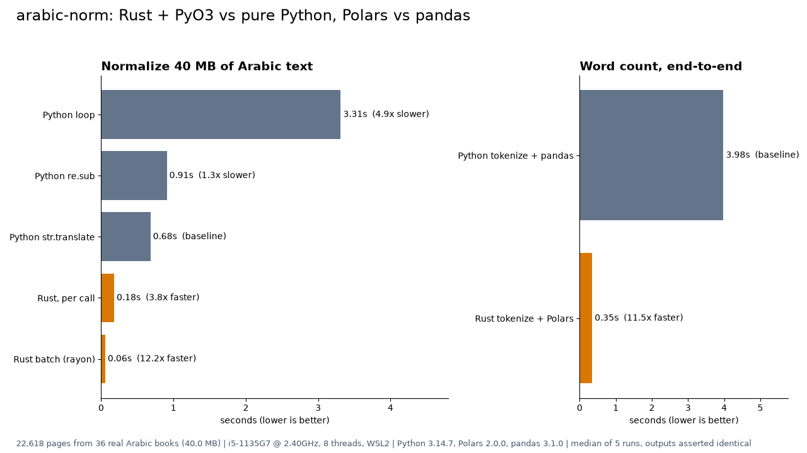

# arabic-norm

Fast Arabic text normalization for search and RAG preprocessing, written in
Rust and exposed to Python with [PyO3](https://pyo3.rs) and
[maturin](https://www.maturin.rs).

It does the cleanup that every Arabic retrieval pipeline needs before
indexing or embedding:

- strip harakat / tashkeel (fatha, kasra, damma, tanwin, shadda, sukun,
  Quranic annotation marks, superscript alif)
- strip tatweel (`العـــلم` → `العلم`)
- unify alif variants `أ إ آ ٱ` → `ا`
- alif maqsura → ya (`ى` → `ي`)
- optional: ta marbuta → ha (`ة` → `ه`)
- optional: replace ASCII and Arabic punctuation (`، ؛ ؟ « » ﴿ ﴾ …`) with spaces
- `tokenize()`: normalize, drop punctuation, split on whitespace
- batch functions that release the GIL and use all cores (rayon)

On 40 MB of real classical Arabic text (Shamela kitab pages) the batch API
normalizes at **~700 MB/s: 12x faster than the fastest pure-Python version
(`str.translate`)** and 59x faster than a plain Python loop. Every number below
comes from `bench/bench.py`, which asserts identical output before timing.



## Install / build

Requires Rust (stable) and [uv](https://docs.astral.sh/uv/).

```bash
uv sync --no-install-project            # dev tools: maturin, pytest, hypothesis, polars, ruff
uv run maturin develop --release        # build the extension into .venv
uv run pytest                           # parity + property tests
```

## Usage

```python
import arabic_norm as an

an.normalize("إِمَامٌ")                      # 'امام'
an.normalize("مُوسَى")                       # 'موسي'
an.normalize("مدرسة", ta_marbuta=True)       # 'مدرسه'
an.tokenize("قَالَ: «الْعِلْمُ نُورٌ»، وَ...")  # ['قال', 'العلم', 'نور', 'و']

pages = [...]                                # list[str], e.g. 20k book pages
clean = an.normalize_batch(pages)            # parallel, GIL released
tokens = an.tokenize_batch_joined(pages)     # one space-joined token string per page
```

All options are keyword-only and default to the common RAG setting:
`strip_tashkeel=True, strip_tatweel=True, normalize_alif=True,
normalize_ya=True, ta_marbuta=False, remove_punct=False`.

With Polars:

```python
import polars as pl
import arabic_norm as an

df = pl.read_ndjson("pages.jsonl")
top = (
    df.with_columns(tok=pl.Series(an.tokenize_batch_joined(df["text"].to_list())))
    .lazy()
    .with_columns(pl.col("tok").str.split(" "))
    .explode("tok")
    .filter(pl.col("tok") != "")
    .group_by("category", "tok").len("n")
    .sort(["category", "n"], descending=[False, True])
    .group_by("category", maintain_order=True).head(20)
    .collect()
)
```

## How it is fast

1. **No UTF-8 round trip.** CPython stores Arabic `str` objects as arrays of
   2-byte code units (PEP 393). Converting to UTF-8 for Rust and back cost more
   than the normalization itself, so the extension reads the code units in
   place and builds the result in the same width
   (`PyUnicode_FromKindAndData`). If nothing changes, the input object is
   returned as is. Measured on the benchmark corpus, the per-call path went
   from 0.35 s (stable-ABI UTF-8 version) to 0.18 s, and the batch path from
   0.22 s to 0.056 s.
2. **Copy runs, not characters.** Unchanged spans are copied in one
   `extend_from_slice`; only edited characters are touched.
3. **Parallel batches without the GIL.** `normalize_batch` and
   `tokenize_batch_joined` take raw views of the input strings, release the
   GIL (`py.detach`), process pages on all cores with rayon, then build the
   output strings.
4. **Return shapes that DataFrames like.** Creating millions of tiny Python
   token objects dominates `tokenize()` (only 2x faster than Python). The
   batch tokenizer returns one space-joined string per page instead, which
   Polars splits natively: 16x faster.

Trade-off: reading CPython internals is not part of the stable ABI (`abi3`),
so wheels are built per CPython minor version.

## Correctness

`python/arabic_norm/reference.py` is a pure-Python implementation and acts as
the specification. `tests/test_parity.py` asserts the Rust output is identical:

- 178 pytest cases: example strings across every option, known outputs, batch
  vs single, lone surrogates, Latin-1-only strings, emoji, Python-compatible
  whitespace (including `\x1c`-`\x1f`, NBSP, em space)
- Hypothesis property tests: 2,000 random strings per function over Arabic,
  punctuation, whitespace and arbitrary code points, with random option sets
- Rust unit tests (`cargo test`) and `cargo clippy --all-targets` clean
- the benchmark asserts all implementations agree on the full 40 MB corpus
  before timing anything

`uv run ruff check` and `uv run ruff format --check` are clean (rules:
E, W, F, I, B, UP, SIM, RUF, PERF, N).

## Benchmarks

Hardware: Intel i5-1135G7 (4 cores / 8 threads) laptop, Windows 11 + WSL2,
Python 3.14.7, pandas 3.1.0, Polars 2.0.0. Data: 22,618 pages from 36
classical Arabic books in 13 subject categories, 40 MB UTF-8. Median of 5
runs. The laptop runs other services 24/7 (load average 3-4 during the run),
so expect roughly +-15% noise. Full table: [bench/results.md](bench/results.md).

| Task | Baseline | Rust / Polars | Speedup |
|---|---:|---:|---:|
| Normalize: Python `str.translate` vs Rust, one call per page | 0.68 s | 0.18 s | 3.8x |
| Normalize: Python `str.translate` vs Rust batch | 0.68 s | 0.056 s | 12.2x |
| Normalize: naive Python loop vs Rust batch | 3.31 s | 0.056 s | 59x |
| Tokenize to joined strings: Python vs Rust batch | 1.11 s | 0.070 s | 15.8x |
| Word count (pre-tokenized): pandas vs Polars lazy | 3.49 s | 0.28 s | 12.4x |
| End-to-end word count: Python + pandas vs Rust + Polars | 3.98 s | 0.35 s | 11.5x |

Honest notes:

- The fair baseline is `str.translate`, not a Python loop. The loop is 4.9x
  slower than `translate`, so "59x" mostly measures slow Python.
- rayon scales sub-linearly here (1 thread 0.19 s, 4 threads 0.08 s,
  8 threads 0.056 s; separate runs of `bench/micro.py`) because building the
  output Python strings stays single-threaded under the GIL, and the laptop
  was busy with other work.
- `tokenize()` returning a Python list is only 2x faster: object creation,
  not text processing, is the bottleneck.

Reproduce:

```bash
uv run python bench/make_sample.py   # <= 40 MB from a local corpus, else synthetic text
uv run python bench/bench.py         # writes bench/results.{json,md}
uv run python bench/chart.py         # writes bench/chart.png (1280x720)
```

The corpus sample stays local (`bench/data/` is git-ignored).

## Case study

**Problem.** A search assistant for classical Islamic books (kitab) indexes
Arabic text for retrieval-augmented generation. The same word appears with
and without harakat, with different hamza forms and with decorative tatweel,
so `إِمَامٌ`, `امام` and `أمام` do not match unless the text is normalized
first. The local corpus holds about 2,800 books / 2.9 million pages, so
normalization and word statistics run over gigabytes of text, and every
full pass in pure Python costs minutes.

**Approach.**

1. Wrote the rules once as a small, readable pure-Python reference.
2. Re-implemented them in Rust with PyO3, reading CPython's internal string
   storage directly to skip UTF-8 conversion, and added rayon batch
   functions that release the GIL.
3. Locked behaviour with parity tests plus Hypothesis property tests
   (thousands of random strings, all option combinations), so the fast
   version cannot drift from the spec.
4. Replaced the pandas split/explode/groupby with a Polars lazy query.
5. Managed the project with uv, linted with Ruff, and benchmarked on real
   book pages with outputs asserted identical before timing.

**Result** (40 MB of real kitab text, consumer laptop):

- normalization: 0.68 s → 0.056 s (12x over the best pure-Python code)
- tokenization for analytics: 1.11 s → 0.07 s (16x)
- end-to-end top-words-per-category report: 3.98 s → 0.35 s (11.5x)
- drop-in API, identical output

```python
# before
clean = [text.translate(TABLE) for text in pages]

# after: same output, parallel, GIL released
import arabic_norm
clean = arabic_norm.normalize_batch(pages)
```

## Limitations

- Normalization is orthographic only: no stemming, lemmatization or
  diacritic restoration.
- `ى` → `ي` conflates words such as `على` / `علي`. That is usual for search
  recall; set `normalize_ya=False` when precision matters.
- Tokenization splits on whitespace and punctuation only; clitics (`و`, `ب`,
  `ال`) are not separated.

## Development

```bash
uv run maturin develop --release
uv run pytest
uv run ruff check && uv run ruff format --check
cargo fmt --check && PYO3_PYTHON=.venv/bin/python cargo clippy --all-targets
# cargo test links libpython, so point the loader at uv's interpreter:
PYO3_PYTHON=.venv/bin/python \
LD_LIBRARY_PATH="$(.venv/bin/python -c 'import sysconfig; print(sysconfig.get_config_var("LIBDIR"))')" \
cargo test --release
```

## License

MIT
